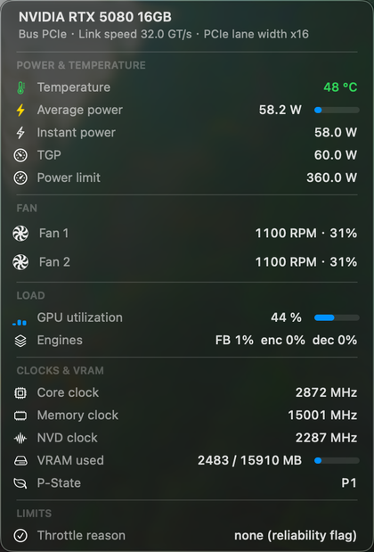
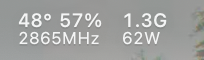

# SMCNvidiaGPU

A VirtualSMC sensor plugin for NVIDIA GPUs. On a Hackintosh it exposes temperature, power draw, per-fan
RPM, clocks, VRAM and the PCIe link to iStat Menus and other monitoring tools.

It is injected by OpenCore (`EFI/OC/Kexts/SMCNvidiaGPU.kext`), never patches the NVIDIA driver, and needs
no background process — all collection happens inside the kext, on the kernel side.

Chinese version: [README.md](README.md)

## Data sources

| Data | Source |
|---|---|
| Temperature | RM `THERMAL_SYSTEM_EXECUTE_V2` |
| Core / memory / NVD clocks | RM `CLK_DOMAINS` |
| Utilisation and engine load | RM `UTIL_V2` |
| P-state | RM `PERF` query |
| VRAM used / total | RUSD |
| Average power, instant power, TGP, power limit | RUSD |
| Per-fan RPM | RUSD `fanCoolerStatus.rpmCurr[]` |
| Throttle reasons, ECC, BAR1 | RUSD (when the firmware fills them) |
| PCIe generation | RUSD |
| PCIe width | `IOPCIExpressLinkStatus` |

RUSD is shared memory maintained by the GSP firmware; only the driver can create it, so the kext creates and
reads it from the kernel side through the driver's own entry points. The RM control commands are issued by
the kext through the driver's internal client.

Two values are not available: **voltage** (`osGetGpuRailVoltage` and its siblings in the driver return
`0x56`) and the **VBIOS version** (the card ROM is not decoded).

## Menu bar app

Requires macOS 12 or later, Intel (x86_64). The bundle is ad-hoc signed, so a downloaded copy may be blocked
once with "cannot be opened because the developer cannot be verified" — right-click → Open, after which it
launches normally.



The menu bar itself shows temperature, utilization, VRAM, clocks and power:



The spinning fan icons are off by default (redrawing them costs about 3% CPU while they are visible). To turn
them on, right-click the menu bar icon and tick **Menu bar → Fans**; one rotor is drawn per detected fan, at
the real speed:


When the card reports zero fans of its own — common on laptops, where the EC owns the cooler — the app falls
back to the system fans: `FNum` for the count, `F<i>Ac` for the speed and `F<i>ID` for the name, and the menu
bar title follows that fan.

Three signals decide whether that fallback applies: the card model (desktop GTX 16 / RTX 20 / 30 / 40 / 50 parts
never fall back, and anything with `Laptop`, `Max-Q` or `Max-P` is treated as a laptop), whether the machine
has a battery, and whether the card has ever reported a fan of its own.

A desktop card keeps showing only its own fans, marked "stopped" when they idle in Zero RPM mode; case fans
never appear there.

Fans are counted per **controller**: fans wired in parallel to the same controller share one RPM reading, so a
card can have more physical fans than rows.

The menu starts with two summary lines: the card name with its VRAM, and the PCIe link (bus, link speed,
lane width — the bus reads "Thunderbolt" when the card sits behind one).

The Swift application in `app/`: left click shows readings, right click shows actions (copy, refresh, start
at login, menu bar contents, language, quit). The fan icon spins at the real RPM with easing; the interface
follows the system light/dark appearance and offers Simplified Chinese, Traditional Chinese and English
(system default, switchable from the menu).

## Tested on

RTX 5080 (GB203), macOS 26.7.1, [NullMoth driver](https://github.com/nullmoth/nvidia-macos-driver) 2.6.4 (NVIDIA 615.78.08).

## Compatibility

- Verified on an RTX 5080 (GB203) with the [NullMoth driver](https://github.com/nullmoth/nvidia-macos-driver) 2.6.2 and 2.6.4 (NVIDIA 615.78.08).
- Other NVIDIA cards should work in principle, but the RUSD layout and the in-driver offsets were extracted
  from 615.78.08.
- The kext carries binding tables for several driver builds and verifies the entry points of each before
  using it, so either version above keeps working; when the driver moves on again, the previous tables are
  kept automatically.

Please open an issue in this repository and include the output of `sysctl kern.nvgpustate`,
`./build/nvstat all`, plus your macOS and NVIDIA driver versions.

## Install

1. Copy `SMCNvidiaGPU.kext` into `EFI/OC/Kexts/`.
2. Add it to `Kernel > Add` in `config.plist` (OCAT or ProperTree will do).
3. Reboot.

From the repository, the script can do it for you (it mounts the ESP, edits `config.plist` and cleans up old
files):

```bash
sudo ./install.sh
./app/install.sh           # menu bar app into ~/Applications, no sudo needed
sudo shutdown -r now
```

Uninstall with `sudo ./install.sh --uninstall`. If the machine no longer boots, add `nvsensoff=1` to
boot-args.

Driver updates change the kernel offsets, so the binding table has to be regenerated from the installed NVRM
and the kext reinstalled. The kext ships binding tables for several driver builds, so an older driver keeps
working; when a build has no table yet, the `nvsmcforce=1` boot argument binds anyway, skipping the signature
check (wrong addresses can panic the kernel, so it is a last resort). Building needs the VirtualSMC and Lilu sources:

```bash
VSMCDIR=/path/to/VirtualSMC LILUDIR=/path/to/Lilu/Lilu kext/build.sh              # release
MODE=debug VSMCDIR=/path/to/VirtualSMC LILUDIR=/path/to/Lilu/Lilu kext/build.sh  # debug
```

## Boot arguments

Add these to OpenCore's `boot-args`:

- `nvsmcforce=1`: bind even when no signature matches after a driver update — the entry checks are skipped and
  the closest table is picked by its anchor. Wrong addresses can panic the kernel, so it is a last resort.
- `nvsensoff=1`: the kext loads but never touches the driver.

## Verify

```bash
sysctl kern.nvgpustate kern.nvgputemp kern.nvgpupower kern.nvgpufan
sysctl kern.nvgpupciegen kern.nvgpupciewidth
./build/nvstat all
```

- `waiting for the NVRM service` in `kern.nvgpustate`: the driver is not up.
- `does not match`: the driver version and the binding table disagree, so rebuild the kext.
- `kern.nvgpurusddump` dumps the whole RUSD block in hex, which is how undecoded fields are found.

## What is exposed

SMC keys:

| Key | Content |
|---|---|
| `TG0D` `TG0P` `TG0d` `TG0p` | GPU temperature (sp78) |
| `F2Ac` `F3Ac` | GPU fan 1/2 RPM (fpe2) |
| `F2Mn` `F2Mx` `F3Mn` `F3Mx` | RPM limits |
| `F2ID` `F3ID` | Fan names (ch8*) |

The GPU accelerator node's `PerformanceStatistics` also carries `Core Clock(MHz)`, `Memory Clock(MHz)`,
`Device Utilization %`, `Fan Speed(RPM)`, `Fan Speed(%)`, `Total Power(W)`, `vramUsedBytes` and the other
keys iStat Menus reads.

iStat Menus shows one extra fan row in percentage form in its GPU panel, because the percentage key is
treated as a separate record; its CPU panel fan reading depends on that key, so it stays. Both clock rows
are titled with the GPU name — the first is the core clock, the second the memory clock.

## License

MIT, see [LICENSE](LICENSE). RUSD structures and the PCIe bit fields come from
[NVIDIA open-gpu-kernel-modules](https://github.com/NVIDIA/open-gpu-kernel-modules) (MIT).

## Acknowledgements

This project builds on other people's work:

- [VirtualSMC](https://github.com/acidanthera/VirtualSMC) and [Lilu](https://github.com/acidanthera/Lilu)
  for the plugin SDK and the kext infrastructure;
- [OpenCore](https://github.com/acidanthera/OpenCorePkg), which lets a third-party kext load before NVRM;
- [NVIDIA open-gpu-kernel-modules](https://github.com/NVIDIA/open-gpu-kernel-modules) for the RUSD shared
  memory layout (`cl00de.h`) and the PCIe bit fields — without that public source this would have been
  guesswork;
- [nullmoth/nvidia-macos-driver](https://github.com/nullmoth/nvidia-macos-driver), the NVRM build used here and
  the source of every offset and machine-code signature in the binding table;
- [iStat Menus](https://bjango.com/mac/istatmenus/), whose keys and display rules defined what this plugin
  had to publish.

And everyone who has wrestled with graphics and sensors on a Hackintosh — the old forum threads and notes
saved a lot of time.
