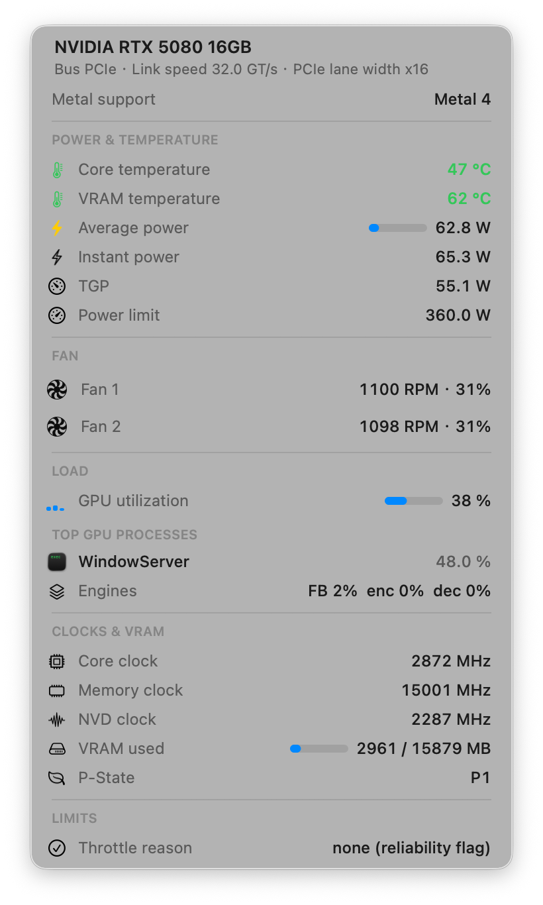
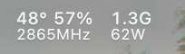

# SMCNvidiaGPU

A VirtualSMC sensor plugin for NVIDIA GPUs. On a Hackintosh it exposes temperature, power draw, per-fan
RPM, clocks, VRAM and the PCIe link to iStat Menus and other monitoring tools.

Scripts and other tools can read the sysctls directly (none of this goes into SMC, so iStat cannot show it):

| Key | Content |
|---|---|
| `kern.nvgputemp` `nvgpupower` `nvgpufan` `nvgutil` | temperature, average power, fan RPM, utilisation |
| `kern.nvgvramused` `nvgvramtotal` | VRAM used / total (MB) |
| `kern.nvggpcclk` `nvgdramclk` `nvgpstate` | core clock, memory clock, p-state |
| `kern.nvgutilfb` `nvgutilenc` `nvgutildec` | memory-bandwidth / encoder / decoder utilisation |
| `kern.nvgpuprocpid0..4` `nvgpuprocutil0..4` `nvgpuprocraw0..4` | busiest GPU processes (pid, integer %, raw ×100) |
| `kern.nvgpudiscover` | how the driver was located (`via=property/platform`, scan result, agreement) |
| `kern.nvgpuvramtemp` | VRAM temperature in °C (0 when the card reports none) |
| `kern.nvgputhermstat` `nvgputhermcount` `nvgputhermraw` | driver-side thermal sensor probe |

`nvgputhermstat` is 1 when the driver accepted the thermal query and `nvgputhermcount` is the sensor count
(1 on this GB203: the GPU sensor only).

It is injected by OpenCore (`EFI/OC/Kexts/SMCNvidiaGPU.kext`), never patches the NVIDIA driver, and needs
no background process — all collection happens inside the kext, on the kernel side.

Chinese version: [README.md](README.md)

## Data sources

| Data | Source |
|---|---|
| Temperature | RM `THERMAL_SYSTEM_EXECUTE_V2` |
| VRAM temperature | RUSD `temperatures[MEMORY]` (GDDR7 on GB203, 15–20 °C above the core) |
| Core / memory / NVD clocks | RM `CLK_DOMAINS` |
| Utilisation and engine load | RM `UTIL_V2` |
| P-state | RM `PERF` query |
| VRAM used / total | RUSD |
| Average power, instant power, TGP, power limit | RUSD |
| Per-fan RPM | RUSD `fanCoolerStatus.rpmCurr[]` |
| Throttle reasons, ECC, BAR1 | RUSD (when the firmware fills them) |
| PCIe generation | RUSD |
| PCIe width | `IOPCIExpressLinkStatus` |

RUSD is shared memory maintained by the GSP firmware; only the driver can create it, so the kext creates and
reads it from the kernel side through the driver's own entry points. The RM control commands are issued by
the kext through the driver's internal client.

Two values are not available: **voltage** (`osGetGpuRailVoltage` and its siblings in the driver return
`0x56`) and the **VBIOS version** (the card ROM is not decoded).

## Menu bar app

The menu bar shows temperature, utilization and VRAM on one line and clocks and power on the other; left click
shows readings (including the busiest GPU processes), right click holds copy, refresh, start at login, menu bar
contents and language.



 

- Power & temperature carries **core** and **VRAM** temperature side by side, both colour-coded as they heat
  up (core 60/75 °C, VRAM 80/92 °C — GDDR7 idles in the low 60s); the VRAM row hides itself when the card
  reports none;
- Fan rotors are drawn per controller at the real speed and are **off by default** (right-click → Menu bar → Fans);
- Fans wired in parallel share one reading; a stopped controller keeps its row, marked "stopped";
- Laptops whose card reports no fan fall back to the system SMC fans; desktop cards never do;
- A separate **Metal support** row under the header shows the Metal device version (e.g. `Metal 4`);
- Temperatures follow the system setting (System Settings → General → Language & Region → Temperature),
  so Celsius and Fahrenheit switch automatically.

## Tested on

RTX 5080 (GB203), macOS 26.7.1, [NullMoth driver](https://github.com/nullmoth/nvidia-macos-driver) 2.8.1 (NVIDIA 620.70.06)
and [GeekAudio 2.8.1 rc3](https://github.com/GeekAudio/nvidia-macos-driver/releases/tag/v2.8.1-geekaudio.1-rc3) (with the #479 telemetry).

## Compatibility

Driver builds tested on an RTX 5080 (GB203) with the
[NullMoth driver](https://github.com/nullmoth/nvidia-macos-driver):

| Driver | Status | Binding table |
|---|---|---|
| 2.5.4 | ✅ | — |
| 2.6.0 | untested | — |
| 2.6.1 | untested | — |
| 2.6.2 | ✅ | 2.6.2 |
| 2.6.3 | ✅ | 2.6.3 |
| 2.6.4 | ✅ | 2.6.4 |
| 2.6.5 | untested | — |
| 2.6.6 | ✅ | 2.6.6 |
| 2.7.0 | untested | — |
| 2.7.1 | ✅ | 2.7.1 |
| 2.7.2 | ✅ | 2.7.2 |
| 2.8 / 2.8.1 (upstream) | ✅ | 2.8 |
| 2.8.1 (GeekAudio rc3) | ✅ | 2.8.1 |

Upstream 2.8.1 keeps the exact code layout of 2.8 (every entry signature is byte-identical), so both use the
2.8 table. [GeekAudio v2.8.1-geekaudio.1-rc3](https://github.com/GeekAudio/nvidia-macos-driver/releases/tag/v2.8.1-geekaudio.1-rc3)
adds the #479 telemetry and is relinked (entries move to the `0x2b6180` area), hence its own table. Either
build is matched automatically; a build that matches nothing is refused rather than mis-called.

**✅** = actually run on that build; **untested** = skipped while upgrading.

Driver **2.7.2 and later** no longer publish the kernel address as a `phys-for-va` property (any process could read it).
From kext **1.8** on the address comes from the `nvDisplayPointers` platform function the driver offers to
kernel clients, with two fallbacks. Kext 1.7 and older cannot locate the driver on 2.7.2, so every sensor
stays empty (it does not crash and never calls the wrong address).

### Relationship to the NVIDIA driver

An open pull request adds power, clock and fan sampling to NVRM itself
([nullmoth/nvidia-macos-driver#479](https://github.com/nullmoth/nvidia-macos-driver/pull/479)); its sensor
selection and monitoring key names follow this project (MIT, credited in that repository's `NOTICE` and
`licenses/`).

The two do not conflict and do different jobs: the driver-side path mainly writes IORegistry
`PerformanceStatistics`; temperature and per-fan RPM still reach iStat Menus through this kext's SMC keys
(`TG0D`/`TG0P`/`TG0d`, `F2Ac`/`F3Ac`), and the menu bar app reads the `kern.nvgpu*` sysctls this kext publishes.

Driver builds carrying the #479 telemetry (currently the GeekAudio branch) publish their own GPU fan SMC keys,
appended after the existing inventory (`FNum` 7→9, `F7Ac`/`F8Ac` here). When that property is present this kext
reports 0 on the slots it adopted (`F2Ac`/`F3Ac`) so fan lists do not show the GPU twice.

Please open an issue in this repository and include the output of `sysctl kern.nvgpustate`,
`./build/nvstat all`, plus your macOS and NVIDIA driver versions.

## Install

1. Copy `SMCNvidiaGPU.kext` into `EFI/OC/Kexts/`.
2. Add it to `Kernel > Add` in `config.plist` (OCAT or ProperTree will do).
3. Reboot.

From the repository, the script can do it for you (it mounts the ESP, edits `config.plist` and cleans up old
files):

```bash
sudo ./install.sh
./app/install.sh           # menu bar app into ~/Applications, no sudo needed
sudo shutdown -r now
```

Uninstall with `sudo ./install.sh --uninstall`. If the machine no longer boots, add `nvsensoff=1` to
boot-args.

Driver updates change the kernel offsets, so the binding table has to be regenerated from the installed NVRM
and the kext reinstalled. The kext ships binding tables for several driver builds, so an older driver keeps
working; when a build has no table yet, the `nvsmcforce=1` boot argument binds anyway, skipping the signature
check (wrong addresses can panic the kernel, so it is a last resort). Building needs the VirtualSMC and Lilu sources:

```bash
VSMCDIR=/path/to/VirtualSMC LILUDIR=/path/to/Lilu/Lilu kext/build.sh              # release
MODE=debug VSMCDIR=/path/to/VirtualSMC LILUDIR=/path/to/Lilu/Lilu kext/build.sh  # debug
```

## Boot arguments

Add these to OpenCore's `boot-args`:

- `nvsmcforce=1`: bind even when no signature matches after a driver update — the entry checks are skipped and
  the closest table is picked by its anchor. Wrong addresses can panic the kernel, so it is a last resort.
- `nvsensoff=1`: the kext loads but never touches the driver.

## Verify

```bash
sysctl kern.nvgpustate kern.nvgputemp kern.nvgpupower kern.nvgpufan
sysctl kern.nvgpupciegen kern.nvgpupciewidth
./build/nvstat all
```

- `waiting for the NVRM service` in `kern.nvgpustate`: the driver is not up.
- `does not match`: the driver version and the binding table disagree, so rebuild the kext.
- `kern.nvgpurusddump` dumps the whole RUSD block in hex, which is how undecoded fields are found.

## What is exposed

SMC keys:

| Key | Content |
|---|---|
| `TG0D` `TG0P` `TG0d` `TG0p` | GPU temperature (sp78) |
| `F2Ac` `F3Ac` | GPU fan 1/2 RPM (fpe2) |
| `F2Mn` `F2Mx` `F3Mn` `F3Mx` | RPM limits |
| `F2ID` `F3ID` | Fan names (ch8*) |

The GPU accelerator node's `PerformanceStatistics` also carries `Core Clock(MHz)`, `Memory Clock(MHz)`,
`Device Utilization %`, `Fan Speed(RPM)`, `Fan Speed(%)`, `Total Power(W)`, `vramUsedBytes` and the other
keys iStat Menus reads.

iStat Menus shows one extra fan row in percentage form in its GPU panel, because the percentage key is
treated as a separate record; its CPU panel fan reading depends on that key, so it stays. Both clock rows
are titled with the GPU name — the first is the core clock, the second the memory clock.

## License

MIT, see [LICENSE](LICENSE). RUSD structures and the PCIe bit fields come from
[NVIDIA open-gpu-kernel-modules](https://github.com/NVIDIA/open-gpu-kernel-modules) (MIT).

## Acknowledgements

This project builds on other people's work:

- [VirtualSMC](https://github.com/acidanthera/VirtualSMC) and [Lilu](https://github.com/acidanthera/Lilu)
  for the plugin SDK and the kext infrastructure;
- [OpenCore](https://github.com/acidanthera/OpenCorePkg), which lets a third-party kext load before NVRM;
- [NVIDIA open-gpu-kernel-modules](https://github.com/NVIDIA/open-gpu-kernel-modules) for the RUSD shared
  memory layout (`cl00de.h`) and the PCIe bit fields — without that public source this would have been
  guesswork;
- [nullmoth/nvidia-macos-driver](https://github.com/nullmoth/nvidia-macos-driver), the NVRM build used here and
  the source of every offset and machine-code signature in the binding table;
- [iStat Menus](https://bjango.com/mac/istatmenus/), whose keys and display rules defined what this plugin
  had to publish.

Special thanks to [Cheng-02](https://github.com/Cheng-02), who contributed the driver 2.8 binding table
(PR #1); it was verified byte for byte here and merged into the fallback tables.

And everyone who has wrestled with graphics and sensors on a Hackintosh — the old forum threads and notes
saved a lot of time.
