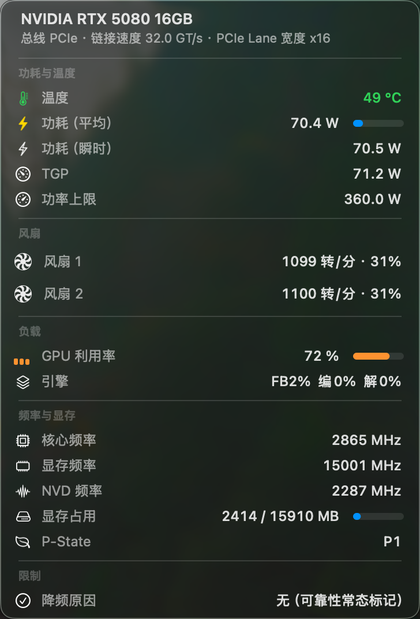

# SMCNvidiaGPU

NVIDIA 显卡的 VirtualSMC 传感器插件。在黑苹果上把温度、功耗、每个风扇的转速、频率、显存和 PCIe
链路提供给 iStat Menus 等监控工具。

通过 OpenCore 注入（`EFI/OC/Kexts/SMCNvidiaGPU.kext`），不修改 NVIDIA 驱动本身，也不需要任何
后台进程 —— 全部采集在 kext 内核侧完成。

English: [README.en.md](README.en.md)

## 数据来源

| 数据 | 来源 |
|---|---|
| 温度 | RM `THERMAL_SYSTEM_EXECUTE_V2` |
| 核心 / 显存 / NVD 频率 | RM `CLK_DOMAINS` |
| 占用率、引擎占用 | RM `UTIL_V2` |
| P-State | RM `PERF` 查询 |
| 显存用量 / 总量 | RUSD |
| 平均功耗、瞬时功耗、TGP、功率上限 | RUSD |
| 每个风扇的转速 | RUSD `fanCoolerStatus.rpmCurr[]` |
| 降频原因、ECC、BAR1 | RUSD（固件提供时） |
| PCIe 代数 | RUSD |
| PCIe 宽度 | `IOPCIExpressLinkStatus` |

RUSD 是 GSP 固件维护的共享内存，只有驱动能创建，kext 借驱动自身的内核入口把它建出来读；RM 的
控制命令由 kext 通过驱动的内部 client 发出。

读不到的两项：**电压**（驱动里的 `osGetGpuRailVoltage` 系列函数直接返回 `0x56`）、**VBIOS 版本**
（显卡 ROM 未解码）。

## 菜单栏程序

系统要求 macOS 12 或更新，Intel 架构（x86_64）。程序是 ad-hoc 签名，从下载的压缩包里双击打开时
系统可能提示"无法验证开发者"，右键 →「打开」即可，之后就能正常双击。



显卡上报的风扇数量为 0 时（笔记本常见，风扇由 EC 控制），程序改读系统 SMC 风扇：`FNum` 取数量、
`F<i>Ac` 取转速、`F<i>ID` 取名字，标题栏也随之显示系统风扇转速。

是否走这条回退由三个条件共同判断：显卡型号（GTX 16 / RTX 20 / 30 / 40 / 50 的台式型号永不回退，
带 `Laptop`、`Max-Q`、`Max-P` 的型号直接判定为笔记本）、机器是否有电池、以及这张卡是否曾经上报过
自己的风扇。台式卡即使风扇停转也不会显示成机箱风扇。

台式卡即使风扇停转（Zero RPM），仍然只显示显卡自己的风扇并标注「停转」，不会混入机箱风扇。

风扇按**控制器**计：同一控制器下并联的两个风扇共用一条转速读数，所以物理风扇数可能多于显示的行数。

菜单顶部两行概况：显卡名字与显存容量，以及 PCIe 链路（总线、链接速度、Lane 宽度；显卡挂在雷雳后面
时总线显示「雷雳」）。

`app/` 下的 Swift 程序：左键显示读数，右键显示操作（复制、刷新、开机自启动、菜单栏显示内容、语言、
退出）。风扇图标按真实转速缓动旋转，界面跟随系统亮色/暗色，提供简体中文、繁體中文、English 三种
语言（默认跟随系统，可在菜单里切换）。

## 环境

RTX 5080（GB203），macOS 26.7.1，[NullMoth 驱动](https://github.com/nullmoth/nvidia-macos-driver) 2.6.4（NVIDIA 615.78.08）。

## 兼容性

- 在 RTX 5080（GB203）+ [NullMoth 驱动](https://github.com/nullmoth/nvidia-macos-driver) 2.6.2、2.6.3 与 2.6.4（NVIDIA 615.78.08）上验证过；
- 其它 NVIDIA 显卡原则上可用，但 RUSD 布局与驱动内的偏移是按 615.78.08 提取的；
- kext 内置多套驱动绑定表，绑定前逐套校验入口函数签名，所以安装上述任一版本的驱动都能工作；
  驱动再次更新后，旧版本的绑定表会被自动保留。

遇到问题请在本仓库的 Issues 里提出，并附上：`sysctl kern.nvgpustate`、`./build/nvstat all` 的输出、
macOS 版本与 NVIDIA 驱动版本。

## 安装

1. 把 `SMCNvidiaGPU.kext` 拷进 `EFI/OC/Kexts/`；
2. 在 `config.plist` 的 `Kernel > Add` 里加一条（OCAT 或 ProperTree 都可以）；
3. 重启。

从仓库安装可以用脚本代劳（会自动挂载 ESP、改写 `config.plist`、清理旧文件）：

```bash
sudo ./install.sh
./app/install.sh           # 菜单栏程序，装到 ~/Applications，不需要 sudo
sudo shutdown -r now
```

卸载：`sudo ./install.sh --uninstall`。若装完无法开机，在 boot-args 加 `nvsensoff=1`。

驱动更新会改变内核偏移，需要按本机 NVRM 重新生成绑定表并重装。kext 内置多个驱动版本的绑定表，
所以旧版本驱动仍然可用；如果某个版本没有对应的表，可以用启动参数 `nvsmcforce=1` 强制绑定
（跳过签名校验，地址不匹配时可能导致内核崩溃，仅在拿不到传感器时临时尝试）。编译依赖 VirtualSMC 与 Lilu 的源码：

```bash
VSMCDIR=/path/to/VirtualSMC LILUDIR=/path/to/Lilu/Lilu kext/build.sh              # 正式版
MODE=debug VSMCDIR=/path/to/VirtualSMC LILUDIR=/path/to/Lilu/Lilu kext/build.sh  # 调试版
```

## 启动参数

加在 OpenCore 的 `boot-args` 里：

- `nvsmcforce=1`：驱动更新后没有匹配的签名也强制绑定，跳过入口校验、按锚点选最接近的一套表；
  地址不对可能导致内核崩溃，仅在读不到传感器时临时用。
- `nvsensoff=1`：让 kext 完全不碰驱动，只加载不读取。

## 验证

```bash
sysctl kern.nvgpustate kern.nvgputemp kern.nvgpupower kern.nvgpufan
sysctl kern.nvgpupciegen kern.nvgpupciewidth
./build/nvstat all
```

- `kern.nvgpustate` 显示 `waiting for the NVRM service`：驱动没起来；
- 显示 `does not match`：驱动版本和绑定表不符，重新编译 kext；
- `kern.nvgpurusddump` 可以导出整个 RUSD 块（十六进制），用来排查未解码的字段。

## 提供给监控工具

SMC 键：

| 键 | 内容 |
|---|---|
| `TG0D` `TG0P` `TG0d` `TG0p` | GPU 温度（sp78） |
| `F2Ac` `F3Ac` | GPU 风扇 1/2 转速（fpe2） |
| `F2Mn` `F2Mx` `F3Mn` `F3Mx` | 转速上下限 |
| `F2ID` `F3ID` | 风扇名称（ch8*） |

GPU 加速器节点的 `PerformanceStatistics` 里另有 `Core Clock(MHz)`、`Memory Clock(MHz)`、
`Device Utilization %`、`Fan Speed(RPM)`、`Fan Speed(%)`、`Total Power(W)`、`vramUsedBytes`
等 iStat Menus 会读取的键。

iStat Menus 的 GPU 面板会把百分比键当成独立记录多显示一条风扇行；它的 CPU 面板风扇读数依赖该键，
因此保留。频率两行都以显卡名作标题，第一行是核心频率，第二行是显存频率。

## 许可

MIT，见 [LICENSE](LICENSE)。RUSD 结构体与 PCIe 位域布局取自
[NVIDIA open-gpu-kernel-modules](https://github.com/NVIDIA/open-gpu-kernel-modules)（MIT）。

## 致谢

这个项目站在别人的成果上：

- [VirtualSMC](https://github.com/acidanthera/VirtualSMC) 与 [Lilu](https://github.com/acidanthera/Lilu)：
  插件 SDK 与 kext 基础设施；
- [OpenCore](https://github.com/acidanthera/OpenCorePkg)：让第三方 kext 能先于 NVRM 注入内核；
- [NVIDIA open-gpu-kernel-modules](https://github.com/NVIDIA/open-gpu-kernel-modules)：RUSD 共享内存
  （`cl00de.h`）与 PCIe 位域布局的定义，没有这份公开源码就只能靠猜；
- [nullmoth/nvidia-macos-driver](https://github.com/nullmoth/nvidia-macos-driver)：本机运行的 NVRM 驱动，
  绑定表的偏移与机器码签名都从它提取；
- [iStat Menus](https://bjango.com/mac/istatmenus/)：监控端的接入目标，键名与显示规则都是以它的行为为准
  一点点对出来的。

以及所有在黑苹果上折腾显示输出和传感器的人 —— 论坛里的旧帖子和踩坑记录省了很多时间。
