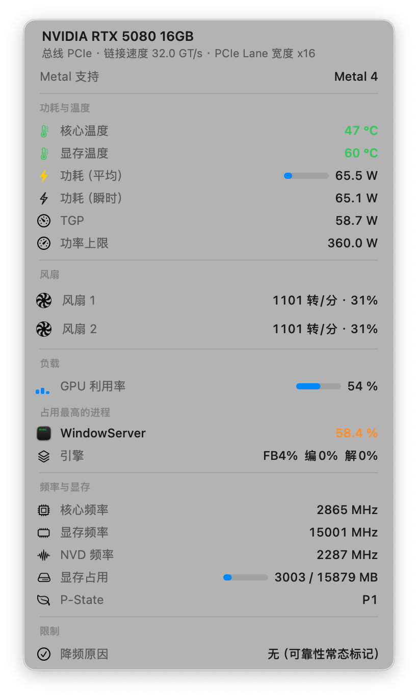
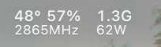

# SMCNvidiaGPU

NVIDIA 显卡的 VirtualSMC 传感器插件。在黑苹果上把温度、功耗、每个风扇的转速、频率、显存和 PCIe
链路提供给 iStat Menus 等监控工具。

通过 OpenCore 注入（`EFI/OC/Kexts/SMCNvidiaGPU.kext`），不修改 NVIDIA 驱动本身，也不需要任何
后台进程 —— 全部采集在 kext 内核侧完成。

English: [README.en.md](README.en.md)

## 数据来源

| 数据 | 来源 |
|---|---|
| 温度 | RM `THERMAL_SYSTEM_EXECUTE_V2` |
| 显存温度 | RUSD `temperatures[MEMORY]`（GB203 上为 GDDR7，约比核心高 15–20 °C） |
| 核心 / 显存 / NVD 频率 | RM `CLK_DOMAINS` |
| 占用率、引擎占用 | RM `UTIL_V2` |
| P-State | RM `PERF` 查询 |
| 显存用量 / 总量 | RUSD |
| 平均功耗、瞬时功耗、TGP、功率上限 | RUSD |
| 每个风扇的转速 | RUSD `fanCoolerStatus.rpmCurr[]` |
| 降频原因、ECC、BAR1 | RUSD（固件提供时） |
| PCIe 代数 | RUSD |
| PCIe 宽度 | `IOPCIExpressLinkStatus` |

RUSD 是 GSP 固件维护的共享内存，只有驱动能创建，kext 借驱动自身的内核入口把它建出来读；RM 的
控制命令由 kext 通过驱动的内部 client 发出。

读不到的两项：**电压**（驱动里的 `osGetGpuRailVoltage` 系列函数直接返回 `0x56`）、**VBIOS 版本**
（显卡 ROM 未解码）。

## 菜单栏程序

菜单栏分两行显示温度、利用率、显存、频率与功耗；左键看读数（含占用最高的进程），右键是复制、刷新、
开机自启动、菜单栏显示内容、语言等操作。



 

- 「功耗与温度」里是**核心温度**和**显存温度**两行，都随温度自动变色（核心 60/75 度、显存 80/92 度
  转橙转红，GDDR7 常温就有 60 多度）；显卡不上报显存温度时该行自动隐藏；
- 风扇转子按控制器数量绘制、按真实转速旋转，**默认关闭**（右键 → 菜单栏显示 → 风扇 打开）；
- 同一控制器下并联的风扇共用一条读数，停转的那一路仍占一行并标注「停转」；
- 显卡不报风扇的笔记本改读系统 SMC 风扇，台式卡永不回退；
- 表头下面单列一行 **Metal 支持**（如 `Metal 4`），取自系统的 Metal 设备信息；
- 温度跟随系统设置（系统设置 → 通用 → 语言与地区 → 温度），摄氏/华氏自动切换；
- `引擎` 一行给出 FB / 编 / 解 / JPG / OFA 五路利用率；功率上限被驱动钳制时显示「生效 ← 请求」，
  笔记本上开驱动的功耗预算（`nvrmtgp=1`）后还会多一行「电源预算」。

## 环境

RTX 5080（GB203），macOS 26.7.1，[NullMoth 驱动](https://github.com/nullmoth/nvidia-macos-driver) 2.9（NVIDIA 620.70.06），
以及 [GeekAudio 2.8.1 rc3](https://github.com/GeekAudio/nvidia-macos-driver/releases/tag/v2.8.1-geekaudio.1-rc3)（含 #479 遥测）。

## 兼容性

在 RTX 5080（GB203）+ [NullMoth 驱动](https://github.com/nullmoth/nvidia-macos-driver)上验证的驱动版本：

| 驱动版本 | 状态 | 绑定表 |
|---|---|---|
| 2.5.4 | ✅ | — |
| 2.6.0 | 未测试 | — |
| 2.6.1 | 未测试 | — |
| 2.6.2 | ✅ | 2.6.2 |
| 2.6.3 | ✅ | 2.6.3 |
| 2.6.4 | ✅ | 2.6.4 |
| 2.6.5 | 未测试 | — |
| 2.6.6 | ✅ | 2.6.6 |
| 2.7.0 | 未测试 | — |
| 2.7.1 | ✅ | 2.7.1 |
| 2.7.2 | ✅ | 2.7.2 |
| 2.8 / 2.8.1（官方） | ✅ | 2.8 |
| 2.8.1（GeekAudio rc3） | ✅ | 2.8.1 |
| 2.9 | ✅ | 2.9 |

**✅** = 实测能用；**未测试** = 升级时跳过、未实测。

上游 2.8.1 与 2.8 的代码布局完全一致（入口签名逐字节相同），所以共用 2.8 的绑定表。
[GeekAudio v2.8.1-geekaudio.1-rc3](https://github.com/GeekAudio/nvidia-macos-driver/releases/tag/v2.8.1-geekaudio.1-rc3)
叠加了 #479 遥测并重新链接过（入口整体移到 `0x2b6180` 一带），因此单独一张表。装哪一版都能自动匹配，
不匹配时只会拒绝绑定、不会乱调。

驱动 **2.7.2 起** 出于安全考虑不再把内核地址写成 `phys-for-va` 属性（任何程序都能读到）。本 kext **1.8 起**
改用驱动留给内核客户端的 `nvDisplayPointers` 平台函数取地址，并保留两条兜底路径；1.7 及更早的 kext
在 2.7.2 上会定位不到驱动、传感器为空（不会崩溃，也不会乱调）。

### 与 NVIDIA 驱动的关系

驱动作者正在评审一个把功率、频率、风扇采样做进 NVRM 本身的 PR
（[nullmoth/nvidia-macos-driver#479](https://github.com/nullmoth/nvidia-macos-driver/pull/479)），
它的传感器选型与监控键名参考了本项目（MIT，已在对方的 `NOTICE` 与 `licenses/` 里署名）。

两者不冲突，作用也不同：驱动原生方案主要写 IORegistry 的 `PerformanceStatistics`；温度、每个风扇的转速
仍是本 kext 通过 SMC 键（`TG0D`/`TG0P`/`TG0d`、`F2Ac`/`F3Ac`）发布给 iStat Menus，菜单栏程序则依赖本 kext
发布的 `kern.nvgpu*` sysctl。

带 #479 遥测的驱动构建（目前是 GeekAudio 分支）会**自己**发布 GPU 风扇的 SMC 键：风扇追加在原有清单之后
（本机 `FNum` 7→9，`F7Ac`/`F8Ac`）。检测到该属性时，本 kext 把自家占用的 `F2Ac`/`F3Ac` 读数置 0，
避免风扇列表里出现两组相同的 GPU 风扇。

遇到问题请在本仓库的 Issues 里提出，并附上：`sysctl kern.nvgpustate`、`./build/nvstat all` 的输出、
macOS 版本与 NVIDIA 驱动版本。

### 实验选项与读数

驱动 2.9 的实验特性里有几项会改变本工具读到的数，属正常现象：

- `nvrmaspm=1`（空闲链路省电）与 `nvrtd3=1`（GPU 深度睡眠）会让 PCIe 链路在空闲时降到 Gen1、
  功耗降到个位数；菜单里显示的是**当前**链路与**当前**功耗，负载上来就恢复。
- `nvrmtgp=1`（笔记本功耗预算）会按电源状态调整功率上限：此时「功率上限」一行出现
  `生效值 ← 请求值`，「电源预算」一行显示跟随交流还是电池。
- AMD 台式机上，1401 会安装 SMCSuperIO 与 VirtualSMC 传感器插件，它们负责**主板**风扇；
  GPU 风扇仍由本 kext 发布在 `F2Ac`/`F3Ac`，检测到驱动自己发布风扇键时本 kext 会让位，不会出现重复。

## 安装

1. 把 `SMCNvidiaGPU.kext` 拷进 `EFI/OC/Kexts/`；
2. 在 `config.plist` 的 `Kernel > Add` 里加一条（OCAT 或 ProperTree 都可以）；
3. 重启。

从仓库安装可以用脚本代劳（会自动挂载 ESP、改写 `config.plist`、清理旧文件）：

```bash
sudo ./install.sh
./app/install.sh           # 菜单栏程序，装到 ~/Applications，不需要 sudo
sudo shutdown -r now
```

卸载：`sudo ./install.sh --uninstall`。若装完无法开机，在 boot-args 加 `nvsensoff=1`。

驱动更新会改变内核偏移，需要按本机 NVRM 重新生成绑定表并重装。kext 内置多个驱动版本的绑定表，
所以旧版本驱动仍然可用；如果某个版本没有对应的表，可以用启动参数 `nvsmcforce=1` 强制绑定
（跳过签名校验，地址不匹配时可能导致内核崩溃，仅在拿不到传感器时临时尝试）。编译依赖 VirtualSMC 与 Lilu 的源码：

```bash
VSMCDIR=/path/to/VirtualSMC LILUDIR=/path/to/Lilu/Lilu kext/build.sh              # 正式版
MODE=debug VSMCDIR=/path/to/VirtualSMC LILUDIR=/path/to/Lilu/Lilu kext/build.sh  # 调试版
```

## 启动参数

加在 OpenCore 的 `boot-args` 里：

- `nvsmcforce=1`：驱动更新后没有匹配的签名也强制绑定，跳过入口校验、按锚点选最接近的一套表；
  地址不对可能导致内核崩溃，仅在读不到传感器时临时用。
- `nvsensoff=1`：让 kext 完全不碰驱动，只加载不读取。

## 验证

```bash
sysctl kern.nvgpustate kern.nvgputemp kern.nvgpupower kern.nvgpufan
sysctl kern.nvgpupciegen kern.nvgpupciewidth
./build/nvstat all
```

- `kern.nvgpustate` 显示 `waiting for the NVRM service`：驱动没起来；
- 显示 `does not match`：驱动版本和绑定表不符，重新编译 kext；
- `kern.nvgpurusddump` 可以导出整个 RUSD 块（十六进制），用来排查未解码的字段。

## 提供给监控工具

SMC 键：

| 键 | 内容 |
|---|---|
| `TG0D` `TG0P` `TG0d` `TG0p` | GPU 温度（sp78） |
| `F2Ac` `F3Ac` | GPU 风扇 1/2 转速（fpe2） |
| `F2Mn` `F2Mx` `F3Mn` `F3Mx` | 转速上下限 |
| `F2ID` `F3ID` | 风扇名称（ch8*） |

GPU 加速器节点的 `PerformanceStatistics` 里另有 `Core Clock(MHz)`、`Memory Clock(MHz)`、
`Device Utilization %`、`Fan Speed(RPM)`、`Fan Speed(%)`、`Total Power(W)`、`vramUsedBytes`
等 iStat Menus 会读取的键。

iStat Menus 的 GPU 面板会把百分比键当成独立记录多显示一条风扇行；它的 CPU 面板风扇读数依赖该键，
因此保留。频率两行都以显卡名作标题，第一行是核心频率，第二行是显存频率。

脚本或其它工具可以直接读 sysctl（这些数据不进 SMC，iStat 看不到）：

| 键 | 内容 |
|---|---|
| `kern.nvgputemp` `nvgpupower` `nvgpufan` `nvgutil` | 温度、平均功耗、风扇转速、利用率 |
| `kern.nvgvramused` `nvgvramtotal` | 显存已用 / 总量（MB） |
| `kern.nvggpcclk` `nvgdramclk` `nvgpstate` | 核心频率、显存频率、P-State |
| `kern.nvgutilfb` `nvgutilenc` `nvgutildec` | 显存带宽 / 编码 / 解码利用率 |
| `kern.nvgpuprocpid0..4` `nvgpuprocutil0..4` `nvgpuprocraw0..4` | 占用最高的几个进程（PID、整数百分比、×100 原始值） |
| `kern.nvgpuvramtemp` | 显存温度（°C，显卡不上报时为 0） |
| `kern.nvgputhermstat` `nvgputhermcount` `nvgputhermraw` | 驱动侧热传感器探测结果 |
| `kern.nvgpudiscover` | 驱动的定位方式（`via=property/platform`、扫描结果、是否一致） |

`nvgputhermstat` 为 1 表示驱动接受了热传感器查询，`nvgputhermcount` 是传感器数量（本机 GB203 为 1，只有 GPU 温度）。

## 许可

MIT，见 [LICENSE](LICENSE)。RUSD 结构体与 PCIe 位域布局取自
[NVIDIA open-gpu-kernel-modules](https://github.com/NVIDIA/open-gpu-kernel-modules)（MIT）。

## 致谢

这个项目站在别人的成果上：

- [VirtualSMC](https://github.com/acidanthera/VirtualSMC) 与 [Lilu](https://github.com/acidanthera/Lilu)：
  插件 SDK 与 kext 基础设施；
- [OpenCore](https://github.com/acidanthera/OpenCorePkg)：让第三方 kext 能先于 NVRM 注入内核；
- [NVIDIA open-gpu-kernel-modules](https://github.com/NVIDIA/open-gpu-kernel-modules)：RUSD 共享内存
  （`cl00de.h`）与 PCIe 位域布局的定义，没有这份公开源码就只能靠猜；
- [nullmoth/nvidia-macos-driver](https://github.com/nullmoth/nvidia-macos-driver)：本机运行的 NVRM 驱动，
  绑定表的偏移与机器码签名都从它提取；
- [iStat Menus](https://bjango.com/mac/istatmenus/)：监控端的接入目标，键名与显示规则都是以它的行为为准
  一点点对出来的。

特别感谢 [Cheng-02](https://github.com/Cheng-02)：驱动 2.8 的绑定表由他提交（PR #1），
在本机上逐字节核对后并入回退表。

以及所有在黑苹果上折腾显示输出和传感器的人 —— 论坛里的旧帖子和踩坑记录省了很多时间。
